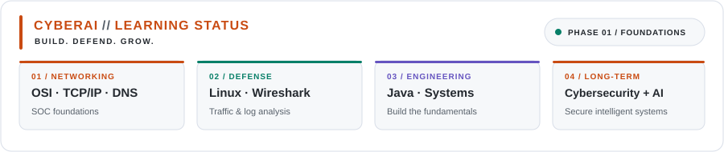
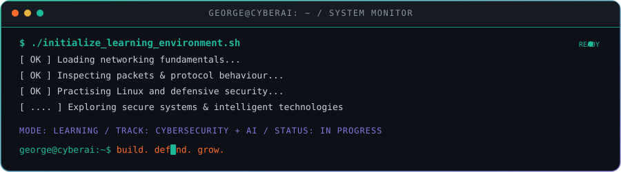

<!-- ═══════════════════════════════════════════════════════════════
     GEORGE OCHIENG — ochiengGeo — GitHub Profile README
     CS Student | CyberAI | SOC-bound
     ═══════════════════════════════════════════════════════════════ -->

<div align="center">

<!-- HEADER BANNER -->


<!-- STATUS BADGES -->
<p>
  
  &nbsp;
  
  &nbsp;
  
</p>

<!-- CYBERAI LEARNING STATUS: the SVG panels include their own styled heading -->
<picture>
  <source
    media="(prefers-color-scheme: dark)"
    srcset="./assets/cyberai-panel-dark.svg"
  />
  <source
    media="(prefers-color-scheme: light)"
    srcset="./assets/cyberai-panel-light.svg"
  />
  
</picture>

</div>

---

## `whoami`

```bash
$ cat /etc/ochiengGeo/identity.conf
```

```yaml
name        : George Ochieng
alias       : Rez
location    : Nairobi, Kenya 🇰🇪
university  : Egerton University — BSc Computer Science (Year 2)
track       : Cybersecurity + Artificial Intelligence (CyberAI)
slogan      : "SUI28"
mission     : Build. Defend. Grow.
```

> *"The foundation is not glamorous. It is just necessary."*
> — Palmer, A Journal of Days

---

## 🧠 Currently Learning

<div align="center">

<picture>
  <source media="(prefers-color-scheme: dark)" srcset="./assets/learning-dashboard-dark.svg" />
  <source media="(prefers-color-scheme: light)" srcset="./assets/learning-dashboard-light.svg" />
  
</picture>

</div>

---

## 📺 Currently Consuming

<div align="center">

<table>
<tr>
<td align="center" width="180">
<br/>
<sub>🎬 Series — keeps the mind sharp</sub>
</td>
<td align="center" width="180">
<br/>
<sub>📡 Networking & cybersecurity labs</sub>
</td>
<td align="center" width="180">
<br/>
<sub>🔍 SOC & DFIR walkthroughs</sub>
</td>
<td align="center" width="180">
<br/>
<sub>💻 Programming fundamentals</sub>
</td>
</tr>
</table>

</div>

---

## 🛠️ Tech Stack & Tools

<table width="100%">
  <tr>
    <td width="50%" valign="top" align="center">
      <h3>💻 Languages</h3>
      <a href="https://skillicons.dev">
        
      </a>
    </td>
    <td width="50%" valign="top" align="center">
      <h3>🖥️ IDE & Environment</h3>
      <a href="https://skillicons.dev">
        
      </a>
    </td>
  </tr>
  <tr>
    <td width="50%" valign="top" align="center">
      <h3>🛡️ Security & Networking</h3>
      
      
      
      
    </td>
    <td width="50%" valign="top" align="center">
      <h3>🎯 Platforms</h3>
      
      
      
      
      
      
    </td>
  </tr>
</table>

---


---
## 📊 GitHub Activity & Statistics

<div align="center">

<picture>
  <source
    media="(prefers-color-scheme: dark)"
    srcset="./assets/cards.dark.svg"
  />
  <source
    media="(prefers-color-scheme: light)"
    srcset="./assets/cards.light.svg"
  />
  
</picture>

</div>


---
## 💻 CYBERAI Terminal // Learning in Progress

<div align="center">
  
</div>

---
## 🎯 2026 Targets

```python
goals_2026 = {
    "foundations"   : ["Complete Phase 1 fundamentals", "30+ TryHackMe rooms", "Wireshark fluency"],
    "certification" : ["Pass CompTIA Security+ SY0-701", "LetsDefend SOC path certificate"],
    "lab"           : ["Deploy home Wazuh SIEM", "5+ documented incident investigations"],
    "the end"       : "remembers everything."
}
```

---

## 🌐 Connect

<div align="center">

[](https://github.com/ochiengGeo)
[](https://www.linkedin.com/in/george-ochieng-cs)
[](https://www.kaggle.com/ochienggeo)
[](mailto:georgeochieng.cs@gmail.com)

</div>

---

<div align="center">


</div>
